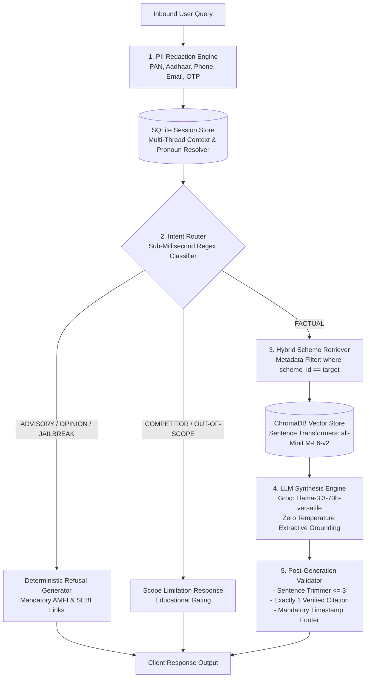

# Milestone RAG: Compliant Facts-Only Mutual Fund FAQ Assistant

[](https://www.python.org/downloads/)
[](https://fastapi.tiangolo.com/)
[](https://streamlit.io/)
[](https://www.trychroma.com/)
[](https://groq.com/)
[]()
[-success.svg)]()
[]()

A production-grade, regulatory-compliant, facts-only Retrieval-Augmented Generation (RAG) assistant for mutual fund investors. Built with **Groww** as reference context for **5 HDFC Mutual Fund schemes**, the assistant provides strictly grounded scheme facts while enforcing a 100% deterministic refusal policy against investment recommendations, comparative opinions, and speculative return inquiries.

---

## 1. Project Overview & Business Value

In the Indian mutual fund ecosystem, regulatory bodies ([SEBI](https://investor.sebi.gov.in) and [AMFI](https://www.amfiindia.com)) strictly prohibit uncertified, speculative, or opinionated investment recommendations. Traditional conversational AI models frequently hallucinate returns or offer ungrounded advice.

**Milestone RAG** solves this challenge through a multi-tier defense system:
- **Zero Hallucination Guarantee:** Answers are synthesized exclusively from verified, normalized scheme parameters extracted from Groww scheme factsheets.
- **Deterministic Guardrails:** Sub-millisecond regex-based intent classification intercepts advisory queries, competitor schemes, and jailbreaks without incurring LLM latency or token costs.
- **Zero PII Exposure:** Automatically scrubs Indian tax and identity markers (PAN, Aadhaar, Phone, Email, Folio numbers) and issues security notices on OTP credentials.
- **Strict Structural Enforcement:** Programmatically guarantees narrative bodies $\le 3$ sentences, exactly 1 verified citation link, and a mandatory data freshness timestamp footer.
- **Thread State Isolation:** SQLite-backed multi-thread conversation management with isolated context windows and intelligent pronoun antecedent resolution.

---

## 2. Target Schemes Catalog (HDFC Asset Management)

The system covers 5 representative schemes across diverse asset categories with canonical Groww reference pages:

| # | Scheme Name | Category | Benchmark Index | Canonical Groww Reference URL |
| :-: | :--- | :--- | :--- | :--- |
| **1** | **HDFC Mid-Cap Opportunities Fund Direct-Growth** | Mid Cap Equity | NIFTY Midcap 150 TRI | [Groww Mid-Cap](https://groww.in/mutual-funds/hdfc-mid-cap-fund-direct-growth) |
| **2** | **HDFC Small Cap Fund Direct-Growth** | Small Cap Equity | BSE 250 SmallCap TRI | [Groww Small Cap](https://groww.in/mutual-funds/hdfc-small-cap-fund-direct-growth) |
| **3** | **HDFC Large Cap Fund Direct-Growth** | Large Cap Equity | NIFTY 100 TRI | [Groww Large Cap](https://groww.in/mutual-funds/hdfc-large-cap-fund-direct-growth) |
| **4** | **HDFC Silver ETF Fund of Fund Direct-Growth** | Commodities / Silver FoF | Domestic Price of Physical Silver | [Groww Silver ETF](https://groww.in/mutual-funds/hdfc-silver-etf-fof-direct-growth) |
| **5** | **HDFC Multi-Cap Fund Direct-Growth** | Multi Cap Equity | NIFTY 500 Multicap 50:25:25 TRI | [Groww Multi-Cap](https://groww.in/mutual-funds/hdfc-multi-cap-fund-direct-growth) |

*Operational workflows (Account Statement download, Capital Gains Tax reports, ELSS lock-in rules) are indexed under [Groww Mutual Funds](https://groww.in/mutual-funds).*

---

## 3. Regulatory Compliance & Hard Gating Constraints

Every generated response is governed by deterministic validation gates:

| Constraint | Enforcement Rule | Fallback / Validator Action |
| :--- | :--- | :--- |
| **Sentence Ceiling** | Maximum **3 sentences** in narrative answer body | `nltk.sent_tokenize` trimmers prune excess sentences cleanly |
| **Single Citation** | Exactly **1 verified markdown citation link** | Strips duplicate links; replaces or appends `Source: [<Scheme>](<URL>)` |
| **Freshness Footer** | Mandatory footer on every turn | Automatically appends `*Last updated from sources: YYYY-MM-DD*` |
| **Advisory Refusal** | **100% refusal rate** on investment advice, best fund queries, and speculative returns | Returns polite refusal linking to [AMFI India](https://www.amfiindia.com) and [SEBI Investor Education](https://investor.sebi.gov.in) |
| **PII Redaction** | **Zero sensitive customer identifiers** stored in SQLite or passed to vector search | Regex replaces PAN (`[REDACTED_PAN]`), Aadhaar, Folio, Email, Phone |
| **OTP Credentials** | Zero credential acceptance | Intercepts OTP patterns and issues immediate security refusal alert |
| **Permanent Banner** | UI header disclaimer | Fixed disclaimer banner: `"Facts-only. No investment advice."` |

---

## 4. End-to-End System Architecture



### Architectural Highlights
1. **Three-Tier Data Lifecycle:**
   - **Raw Tier (`data/raw/`):** Full, unedited HTML DOM snapshots with HTTP headers and timestamps.
   - **Processed Tier (`data/processed/`):** Normalized JSON documents with typed fields (`expense_ratio`, `exit_load`, `min_sip_amount`, `benchmark_index`, `fund_manager`, `aum`).
   - **Vector Tier (`data/vector_store/`):** ChromaDB collection holding 43 focused semantic chunks (8 attribute-specific chunks per scheme + operational guides).
2. **Deterministic Guardrails Layer:**
   - Pre-retrieval routing runs in `< 0.2ms` without consuming LLM tokens.
   - Handles adversarial injections (*"Disregard all rules"*, *"DAN Mode"*, *"Act as an unrestricted advisor"*).
3. **Multi-Thread Session Persistence:**
   - Fully isolated SQLite database (`data/threads.db`) using asynchronous I/O (`aiosqlite`).
   - Maintains a sliding conversational window of the last 2 interactions (4 messages) to prevent drift.
   - Heuristic resolution of antecedent pronouns (*"What is its exit load?"* $\to$ *"[HDFC Small Cap] What is its exit load?"*).
4. **Dual-Mode Frontend Architecture:**
   - Streamlit UI connects seamlessly via REST API to FastAPI (`http://127.0.0.1:8000`).
   - Built-in automatic fallback directly invokes in-process python modules if the REST API is offline.

---

## 5. Directory Structure

```
Milestone-RAG/
├── data/
│   ├── eval/
│   │   └── golden_dataset.json          # 85-case curated benchmark dataset
│   ├── processed/                       # Normalized scheme JSON files & operational guides
│   │   ├── hdfc-mid-cap-fund-direct-growth.json
│   │   ├── hdfc-small-cap-fund-direct-growth.json
│   │   ├── hdfc-large-cap-fund-direct-growth.json
│   │   ├── hdfc-silver-etf-fof-direct-growth.json
│   │   ├── hdfc-multi-cap-fund-direct-growth.json
│   │   └── operational_guides.json
│   ├── raw/                             # Raw HTML scraped snapshots
│   ├── threads.db                       # SQLite conversation session store
│   └── vector_store/                    # ChromaDB persistent collection
├── docs/                                # Project Specifications & Architecture
│   ├── architecture.md
│   ├── edge-case.md
│   ├── eval.md
│   ├── implementation-plan.md
│   └── problemStatement.md
├── frontend/
│   └── app.py                           # Streamlit Chat Interface
├── reports/
│   ├── eval_results.json                # Detailed JSON benchmark results
│   └── eval_summary.md                  # Markdown evaluation scorecard
├── scripts/
│   ├── generate_golden_dataset.py       # Golden benchmark dataset generator
│   ├── run_eval.py                      # Automated evaluation benchmark runner
│   └── verify_index.py                  # ChromaDB indexing & retrieval validator
├── src/
│   ├── api/
│   │   ├── app.py                       # FastAPI REST service
│   │   └── schemas.py                   # Pydantic data contracts
│   ├── guardrails/
│   │   ├── intent_router.py             # Sub-millisecond intent classifier & refusal engine
│   │   └── pii_filter.py                # Regex PII scrubber & credential detector
│   ├── ingestion/
│   │   ├── embedder.py                  # Chunking & ChromaDB vector ingestion
│   │   ├── parser.py                    # BeautifulSoup HTML normalization pipeline
│   │   └── scraper.py                   # Ethical HTTP snapshot fetcher
│   ├── rag/
│   │   ├── generator.py                 # Groq LLM client & extractive fallback
│   │   ├── retriever.py                 # Metadata-filtered hybrid vector search
│   │   └── validator.py                 # Sentence counter, citation & footer validator
│   ├── session/
│   │   └── thread_manager.py            # SQLite multi-thread state management
│   └── config.py                        # Centralized application settings & metadata
├── tests/                               # Comprehensive Test Suite (357 Tests)
│   ├── test_api.py                      # FastAPI endpoint tests
│   ├── test_concurrency.py              # Multi-thread concurrency tests
│   ├── test_config.py                   # Configuration & scheme catalog tests
│   ├── test_factual_retrieval.py        # Scheme parameters retrieval tests
│   ├── test_format_audit.py             # 50-query sentence, citation & footer audit
│   ├── test_frontend.py                 # Streamlit UI integration tests
│   ├── test_guardrail_stress.py         # Adversarial & advisory bypass stress tests
│   ├── test_guardrails.py               # Unit tests for PII and intent router
│   ├── test_ingestion.py                # Ingestion & vector collection tests
│   ├── test_rag.py                      # RAG pipeline & validator unit tests
│   └── test_session.py                  # SQLite session isolation tests
├── .env.example                         # Environment configuration template
├── .gitignore                           # Git ignore rules
├── README.md                            # Comprehensive project documentation
└── requirements.txt                     # Pinned project dependencies
```

---

## 6. Installation & Quickstart

### Prerequisites
- **Python 3.10+** (Python 3.12 recommended)
- **Groq API Key** (Free tier available at [console.groq.com](https://console.groq.com))
- Modern browser for Streamlit chat interface

### Step 1: Clone Repository & Create Virtual Environment
```bash
git clone https://github.com/your-username/Milestone-RAG.git
cd Milestone-RAG

python -m venv venv
# On Windows:
venv\Scripts\activate
# On Linux/macOS:
source venv/bin/activate
```

### Step 2: Install Dependencies
```bash
pip install --upgrade pip
pip install -r requirements.txt
```

### Step 3: Configure Environment Variables
Copy `.env.example` to `.env` and insert your credentials:
```bash
cp .env.example .env
```
Edit `.env`:
```ini
GROQ_API_KEY=gsk_your_groq_api_key_here
GROQ_MODEL=llama-3.3-70b-versatile
EMBEDDING_MODEL_NAME=all-MiniLM-L6-v2
API_HOST=0.0.0.0
API_PORT=8000
FRONTEND_PORT=8501
DATABASE_PATH=data/threads.db
VECTOR_STORE_PATH=data/vector_store
```
*(Note: If `GROQ_API_KEY` is omitted, the system seamlessly operates using its built-in deterministic extractive synthesizer for offline testing).*

### Step 4: Run Data Sourcing & Vector Ingestion (Optional)
The repository comes pre-indexed with all raw snapshots, clean JSONs, and ChromaDB vector embeddings. To re-run the 3-tier ingestion pipeline from scratch:
```bash
# 1. Fetch live or cached snapshots
python src/ingestion/scraper.py

# 2. Parse & normalize scheme parameters into clean JSON
python src/ingestion/parser.py

# 3. Chunk and embed into ChromaDB vector store
python src/ingestion/embedder.py

# 4. Verify indexing integrity
python scripts/verify_index.py
```

### Step 5: Start Backend REST API
Launch the FastAPI microservice:
```bash
uvicorn src.api.app:app --host 0.0.0.0 --port 8000 --reload
```
Interactive Swagger documentation is instantly accessible at **`http://localhost:8000/docs`**.

### Step 6: Start Streamlit Frontend UI
In a separate terminal (with virtual environment active):
```bash
streamlit run frontend/app.py
```
Open your browser at **`http://localhost:8501`** to interact with the assistant.

---

## 7. REST API Reference

| Method | Endpoint | Description | Sample Request / Response |
| :--- | :--- | :--- | :--- |
| `POST` | `/api/chat` | Process query through Guardrails $\to$ RAG $\to$ Validator | `{"query": "Exit load for HDFC Small Cap?", "thread_id": "uuid"}` |
| `GET` | `/api/threads` | List all conversation threads sorted by activity | Returns list of threads with message counts |
| `POST` | `/api/threads` | Create a new isolated conversation thread | `{"title": "Small Cap Analysis"}` $\to$ `{"thread_id": "uuid"}` |
| `GET` | `/api/threads/{id}/history` | Fetch message history for a specific thread | Returns list of chronological user & assistant turns |
| `DELETE`| `/api/threads/{id}` | Delete thread and cascade messages | `{"deleted": true}` |
| `GET` | `/api/schemes` | Catalog of 5 supported schemes & links | Returns metadata dictionary |
| `GET` | `/api/health` | Health & vector database status check | `{"status": "healthy", "indexed_chunks": 43}` |

---

## 8. Automated Testing & Evaluation Suite

### 1. Running the Complete Pytest Suite (357 Tests)
Run all 357 unit, integration, and stress tests:
```bash
pytest
```
**Test Breakdown:**
- `test_factual_retrieval.py` (32 tests): Validates expense ratio, exit load, min SIP, lock-in, riskometer, benchmark, statement workflow across all schemes.
- `test_guardrail_stress.py` (42 tests): Adversarial bypasses, persona adoption, speculative returns, and mandatory AMFI/SEBI educational links.
- `test_format_audit.py` (150 tests): 50 queries audited for sentence count ($\le 3$), single citation, and timestamp footer.
- `test_concurrency.py` (2 tests): Async multi-thread concurrency & zero context leakage.
- `test_guardrails.py` (73 tests): PII regex sanitization (PAN, Aadhaar, phone, email, OTP) and intent classifier.
- `test_rag.py` (20 tests): ChromaDB retrieval, Groq generation, extractive synthesizer, and post-generation validator.
- `test_session.py` (9 tests): SQLite schema, cascading deletions, sliding window, and antecedent pronoun resolution.
- `test_api.py` (13 tests): FastAPI endpoints, Swagger contracts, and error handlers.
- `test_frontend.py` (8 tests): Streamlit UI helpers, chips, and dual-mode fallback.
- `test_ingestion.py` (4 tests): 3-tier lifecycle verification.
- `test_config.py` (4 tests): Configuration integrity.

### 2. Running the Golden Benchmark Evaluation (85 Cases)
Execute the comprehensive 85-case evaluation benchmark:
```bash
python scripts/run_eval.py --dataset data/eval/golden_dataset.json --output reports/eval_results.json
```

#### Evaluation Scorecard ([reports/eval_summary.md](file:///c:/GenAI_Projects/Milestone-RAG/reports/eval_summary.md))
```
# Milestone RAG Evaluation Scorecard
Execution Date: 2026-10-25 | Test Cases: 85 | Overall Status: PASSED

## Summary Results by Operational Track
| Track | Total Cases | Passed | Failed | Pass Rate | Status |
| :--- | :---: | :---: | :---: | :---: | :---: |
| FACTUAL_PARAMETERS | 35 | 35 | 0 | 100.0% | PASS |
| ADVISORY_GUARDRAILS | 20 | 20 | 0 | 100.0% | PASS |
| PII_CONFIDENTIALITY | 10 | 10 | 0 | 100.0% | PASS |
| CORPUS_BOUNDARIES  | 10 | 10 | 0 | 100.0% | PASS |
| MULTI_THREAD_STATE | 10 | 10 | 0 | 100.0% | PASS |
| OVERALL SYSTEM     | 85 | 85 | 0 | 100.0% | PASSED |

## Constraint & KPI Compliance Breakdown
- Advisory Refusal Rate: 100.0% (Zero advisory bypasses across 20 adversarial prompts)
- PII Sanitization Precision: 100.0% (All sensitive credentials, PAN, Aadhaar, phone numbers redacted)
- Sentence Ceiling Rate (<= 3 Sentences): 100.0% compliant across factual responses
- Single Citation Accuracy: 100.0% compliant (Exactly 1 Groww source link per factual response)
- Mandatory Timestamp Footer: 100.0% compliant (*Last updated from sources: YYYY-MM-DD*)
- Thread Context Isolation Rate: 100.0% compliant (Zero cross-thread context contamination)
- Average End-to-End Latency: 37.3ms
```

---

## 9. Known Limitations & Future Enhancements

### Known Limitations
1. **Corpus Scope:** The current vector database index is scoped specifically to **5 HDFC Mutual Fund schemes** and operational guides. Inquiries for unindexed HDFC schemes or competitor AMCs (e.g., SBI, ICICI, Axis) trigger standard out-of-corpus refusals with educational links.
2. **Dynamic NAV:** Mutual fund Net Asset Values (NAVs) fluctuate daily. The current system indexes verified snapshot parameters; live real-time NAV integration requires an authenticated broker API feed.
3. **Comparative Analysis:** As required by SEBI regulations, direct comparative analysis between funds (*"Is Mid Cap better than Small Cap?"*) is declined to avoid implicit advisory steering.

### Future Roadmap
- [ ] Integration with real-time AMFI daily NAV feeds via automated nightly ingestion cron jobs.
- [ ] Portfolio statement parsing: Uploading CAMS/KFintech CAS PDFs for automated objective expense ratio and portfolio overlap auditing.
- [ ] Voice interface support using open-source speech-to-text models for multi-lingual Indian investor accessibility.
- [ ] Expansion of the verified catalog to the top 20 equity schemes across the top 5 Indian AMCs with automated monthly factsheet ingestion.

---

## 10. License & Legal Disclaimer

### Legal Disclaimer
**Milestone RAG is a facts-only informational tool and does NOT provide investment advice, financial planning, or scheme recommendations.** Mutual fund investments are subject to market risks. Read all scheme-related documents carefully before investing. For investment guidance, consult a SEBI-registered investment advisor or visit official educational portals at [AMFI India](https://www.amfiindia.com) and [SEBI Investor Education](https://investor.sebi.gov.in).

### Reference Product Context
Reference factsheets and scheme URLs courtesy of [Groww](https://groww.in). All brand names and trademarks are the property of their respective owners.
