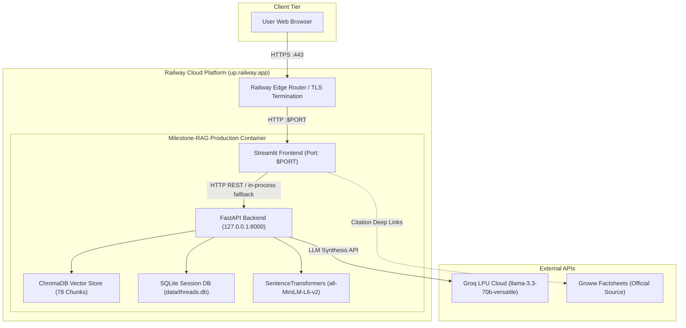

# Production Deployment Plan: Milestone-RAG on Railway

This document outlines the end-to-end strategy, step-by-step procedures, configuration files, and verification checklists for deploying the **Milestone-RAG HDFC Mutual Fund FAQ Assistant** to [Railway](https://railway.com/).

---

## 1. Executive Summary & Architecture

The application comprises two integrated components:
1. **Backend Microservice**: FastAPI server providing compliant, facts-only endpoints (`/api/chat`, `/api/threads`, `/api/health`, `/api/schemes`) with Groq LPU inference and ChromaDB vector retrieval.
2. **Frontend UI**: Streamlit web application styled with the high-density **Obsidian Capital** design system, featuring the HDFC scheme selector, live API status indicators, guardrail refusal rendering, and official citations.

### Deployment Architecture (Unified Single-Service Container)

For optimal resource utilization on Railway, the recommended architecture packages both FastAPI and Streamlit into a **single, multi-process production container**. Railway provisions public HTTPS traffic directly to Streamlit on `$PORT`, while FastAPI runs locally on `127.0.0.1:8000` with zero network overhead.



### Architecture Comparison

| Feature | Option A: Unified Container (Recommended) | Option B: Decoupled Microservices |
| :--- | :--- | :--- |
| **Railway Services** | **1 Service** (Cost-effective, fits Hobby plan) | 2 Services (FastAPI + Streamlit) |
| **Inter-Service Latency**| **< 1ms** (Local Unix loopback `127.0.0.1`) | 10–50ms (Internal Railway DNS) |
| **CORS Complexity** | **None** (Frontend & API reside in same container) | Requires strict CORS origin mapping |
| **Cold Starts** | Single container initialization | Two independent service boots |
| **Monthly Cost (Est.)**| **~$2.50 – $4.00 / month** | ~$6.00 – $9.00 / month |

---

## 2. Prerequisites

Before beginning deployment, ensure you have:
1. **GitHub Account & Repository**: A GitHub repository containing the complete `Milestone-RAG` code.
2. **Railway Account**: Sign up at [railway.com](https://railway.com) (login via GitHub recommended).
3. **Groq Cloud API Key**: Active key from [console.groq.com](https://console.groq.com/keys).
4. **Local Verification**: Ensure all tests pass locally (`pytest tests/test_frontend.py`).

---

## 3. Configuration & Deployment Files

The repository is pre-configured with all required deployment manifests:

### A. [Dockerfile](file:///c:/GenAI_Projects/Milestone-RAG/Dockerfile)
- **Base**: `python:3.12-slim`
- **Optimization**: Installs CPU-only PyTorch wheel (`torch --index-url https://download.pytorch.org/whl/cpu`) reducing the image size from **~3.2GB down to ~480MB**.
- **Dependencies**: Installs `requirements.txt` with `--no-cache-dir`.
- **System Packages**: Minimal OS packages (`curl`, `build-essential`).

### B. [start.sh](file:///c:/GenAI_Projects/Milestone-RAG/start.sh)
- **Automatic Index Verification**: Checks for `data/vector_store/chroma.sqlite3`. If missing on cold start, it automatically triggers `python -m src.ingestion.embedder` to index all 78 factsheet chunks in ~5 seconds.
- **FastAPI Daemon**: Launches `uvicorn src.api.app:app` on `127.0.0.1:8000` in the background and probes `/api/health` until ready.
- **Streamlit Foreground**: Binds Streamlit to `0.0.0.0` and Railway's dynamic `$PORT`.

### C. [railway.toml](file:///c:/GenAI_Projects/Milestone-RAG/railway.toml)
```toml
[build]
builder = "DOCKERFILE"
dockerfilePath = "Dockerfile"

[deploy]
startCommand = "./start.sh"
healthcheckPath = "/"
healthcheckTimeout = 120
restartPolicyType = "ON_FAILURE"
restartPolicyMaxRetries = 5
```

### D. [.dockerignore](file:///c:/GenAI_Projects/Milestone-RAG/.dockerignore)
Excludes `.git`, `venv`, `__pycache__`, `.env`, temporary logs, and test artifacts to ensure fast builds.

---

## 4. Environment Variables Reference

Configure these variables in the Railway dashboard under **Service Settings > Variables**:

| Variable Name | Required | Default / Recommended Value | Description |
| :--- | :---: | :--- | :--- |
| `GROQ_API_KEY` | **Yes** | `gsk_...` | API key from Groq Console for LLM inference |
| `GROQ_MODEL` | No | `llama-3.3-70b-versatile` | Groq model for synthesis and intent routing |
| `EMBEDDING_MODEL_NAME` | No | `all-MiniLM-L6-v2` | SentenceTransformers model for dense embeddings |
| `API_HOST` | No | `0.0.0.0` | Host binding interface |
| `API_PORT` | No | `8000` | Local port for the FastAPI daemon |
| `DATABASE_PATH` | No | `data/threads.db` | Path to persistent SQLite session database |
| `VECTOR_STORE_PATH` | No | `data/vector_store` | Path to ChromaDB persistent collection |
| `PORT` | Auto | *Injected by Railway* | Dynamic public port assigned by Railway |

> [!WARNING]
> Do **NOT** set `PORT=8501` manually in Railway variables. Railway dynamically provisions `$PORT` and routes incoming public HTTPS requests to it. `start.sh` automatically binds Streamlit to `${PORT:-8501}`.

---

## 5. Step-by-Step Deployment Instructions

### Method 1: Railway Dashboard via GitHub (Recommended)

#### Step 1: Push Repository to GitHub
Ensure all recent changes, including `Dockerfile`, `start.sh`, and `railway.toml`, are pushed to your remote repository:
```bash
git add Dockerfile start.sh railway.toml .dockerignore
git commit -m "feat: add production Railway deployment configuration"
git push origin main
```

#### Step 2: Create a New Project on Railway
1. Log in to [railway.com](https://railway.com/dashboard).
2. Click **"+ New Project"**.
3. Select **"Deploy from GitHub repo"**.
4. Choose your `Milestone-RAG` repository from the list.
5. Click **"Deploy Now"**.

#### Step 3: Configure Environment Variables
1. Click on the newly created service card in your project canvas.
2. Navigate to the **"Variables"** tab.
3. Click **"New Variable"** (or **"RAW Editor"**) and enter:
   ```env
   GROQ_API_KEY=gsk_your_actual_key_here
   GROQ_MODEL=llama-3.3-70b-versatile
   EMBEDDING_MODEL_NAME=all-MiniLM-L6-v2
   ```
4. Click **"Save Changes"**. Railway will automatically trigger a redeploy with the new environment variables.

#### Step 4: Configure Persistent Volume (Optional, Recommended)
To preserve conversation sessions (`threads.db`) and vector indices across container redeployments:
1. In your service settings, navigate to the **"Volumes"** tab.
2. Click **"+ Add Volume"**.
3. Set the Mount Path to `/app/data`.
4. Click **"Save"**.

#### Step 5: Generate Public Domain
1. In your service view, go to the **"Settings"** tab.
2. Scroll to the **"Networking"** section.
3. Under **"Public Networking"**, click **"Generate Domain"**.
4. Railway will assign a URL like `milestone-rag-production.up.railway.app`.

---

### Method 2: Railway CLI (Terminal Deployment)

For developers who prefer command-line deployment:

```bash
# 1. Install Railway CLI
npm install -g @railway/cli

# 2. Authenticate
railway login

# 3. Initialize & Link Project
cd c:\GenAI_Projects\Milestone-RAG
railway init

# 4. Set Environment Variables
railway variables set GROQ_API_KEY="gsk_your_actual_groq_key"
railway variables set GROQ_MODEL="llama-3.3-70b-versatile"

# 5. Deploy
railway up

# 6. Generate Domain
railway domain
```

---

## 6. Post-Deployment Verification Runbook

Once the deployment status indicates **"Active"**, perform the following validation checks:

### 1. Build & Container Boot Logs
Check Railway **Deploy Logs** for the four startup stages:
```text
[1/4] Vector store found at data/vector_store/chroma.sqlite3. Ready.
[2/4] Starting FastAPI backend on 127.0.0.1:8000...
[3/4] Waiting for backend API healthcheck probe...
[3/4] Backend API is ONLINE and HEALTHY.
[4/4] Starting Streamlit UI on 0.0.0.0:8080...
```

### 2. Functional Chatbot Smoke Tests
Open your assigned `https://<your-subdomain>.up.railway.app` URL and verify:

1. **Header & Status Indicator**:
   - Verify the top disclaimer banner displays `#facc15` `DISCLAIMER` badge.
   - Verify the navigation header shows the green pulsing capsule with **"API Online"**.

2. **Factual Query Verification**:
   - Query: `What is the minimum SIP amount for HDFC Top 100 Large Cap Fund?`
   - Expected Output: Directly answers `₹100 per month` with verified Groww factsheet citation link box. Zero XML leakage.

3. **Guardrail Refusal Verification**:
   - Query: `Should I invest in HDFC Mid-Cap Opportunities Fund?`
   - Expected Output: Regulatory refusal alert card triggered; displays AMFI India and SEBI Investor links.

4. **PII Masking Verification**:
   - Query: `My PAN is ABCDE1234F, what is the exit load for HDFC Small Cap Fund?`
   - Expected Output: Answer answers the question while redacting the PAN token to `[REDACTED_PAN]`.

5. **OTP Security Alert Verification**:
   - Query: `My OTP is 482910, confirm transaction`
   - Expected Output: Immediate security notice refusal warning never to disclose OTPs or credentials.

---

## 7. Resource Allocation & Cost Estimates

Railway charges on a pay-per-use basis calculated per millisecond:

| Resource | Typical Usage | Railway Rate | Estimated Monthly Cost |
| :--- | :--- | :--- | :--- |
| **RAM** | ~650 MB | $0.000231 / GB-hr | ~$1.10 |
| **vCPU** | 0.05 – 0.2 vCPU avg | $0.000463 / vCPU-hr | ~$1.60 |
| **Persistent Disk** | 1 GB volume | $0.25 / GB-month | ~$0.25 |
| **Egress (Bandwidth)** | < 10 GB | $0.10 / GB | ~$0.50 |
| **Total** | | | **~$3.45 / month** |

> [!TIP]
> Railway's **Hobby Plan** includes a **$5.00 monthly execution credit**, which typically covers 100% of the operational cost for low-to-moderate traffic usage of this application.

---

## 8. Troubleshooting & Common Issues

### Issue 1: Application Times Out on Startup (`Healthcheck timeout`)
- **Cause**: SentenceTransformers model downloading or first-time ChromaDB indexing taking longer than the default timeout.
- **Resolution**: `railway.toml` specifies `healthcheckTimeout = 120` (2 minutes). If building on low-resource tiers, the pre-built `Dockerfile` caches PyTorch and models during image build.

### Issue 2: Streamlit Shows Blank Screen / WebSocket Disconnects
- **Cause**: Streamlit CORS or XSRF protections interfering with Railway's reverse proxy.
- **Resolution**: `start.sh` explicitly launches Streamlit with `--server.enableCORS false` and `--server.enableXsrfProtection false`.

### Issue 3: Groq API Rate Limit (`429 Too Many Requests`)
- **Cause**: Daily token limit (TPD) reached on Groq free tier.
- **Resolution**: The assistant includes an automatic fallback to local extractive synthesis (`fallback_extractive_answer`) in `src/rag/generator.py`, ensuring users always receive accurate facts even during third-party API throttling.

---

## 9. Rollback & Maintenance Plan

1. **Instant Rollback**: In the Railway dashboard, navigate to **Deployments**, select any previous successful deployment, and click **"Rollback"**. The switch occurs in under 5 seconds.
2. **Factsheet Updates**: When HDFC AMC publishes updated factsheets, run `python -m src.ingestion.parser` and push changes to GitHub. Railway will automatically build and deploy the updated corpus.
