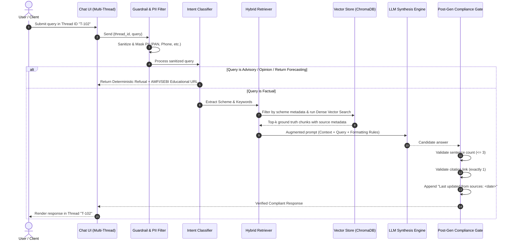
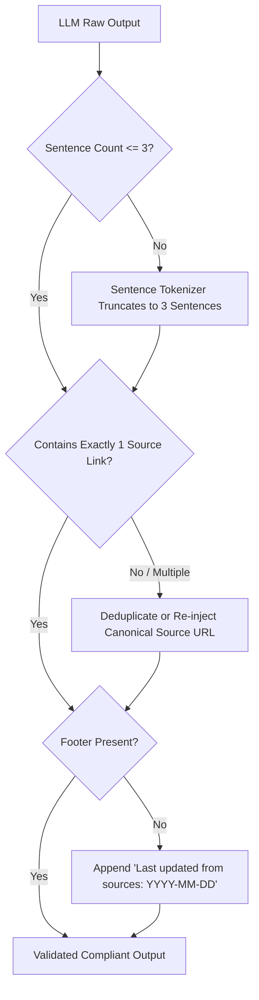

# System Architecture: Facts-Only Mutual Fund FAQ Assistant (Milestone RAG)

## 1. Architecture Overview & Design Principles

The **Milestone RAG** system is engineered as an enterprise-grade, compliant, facts-only financial information retrieval platform. Mutual fund regulations (SEBI/AMFI) require absolute determinism and source attribution while strictly forbidding automated investment advice, subjective opinions, or return forecasting.

```
       +-------------------------------------------------------------+
       |                         Client Layer                        |
       |  - Persistent Disclaimer: "Facts-only. No investment advice"|
       |  - Multi-Thread Conversation Manager                        |
       |  - Starter Prompts & Source Citation Renderer               |
       +------------------------------+------------------------------+
                                      | HTTP / SSE / WebSocket
                                      v
+--------------------------------------------------------------------------+
|                            Application Server                            |
|                                                                          |
|  +------------------------+   +-------------------+   +---------------+  |
|  | Thread & State Manager |   | PII Sanitization  |   | Intent Router |  |
|  | (SQLite / In-Memory)   |   | (Regex / Scrub)   |   | & Guardrails  |  |
|  +------------------------+   +-------------------+   +-------+-------+  |
|                                                               |          |
|                 +---------------------------------------------+          |
|                 | (Advisory / Comparison / Opinion)                      |
|                 v                                                        |
|  +-------------------------------+                                       |
|  | Deterministic Refusal Engine  |                                       |
|  | (SEBI/AMFI Educational Link)  |                                       |
|  +---------------+---------------+                                       |
|                  |                                                       |
|                  | (Factual Query)                                       |
|                  v                                                       |
|  +--------------------------------------------------------------------+  |
|  | Hybrid Retrieval Engine                                            |  |
|  | - Metadata Filter (Scheme / Category)                              |  |
|  | - Vector Similarity (ChromaDB / FAISS)                             |  |
|  | - BM25 Keyword Search                                              |  |
|  +---------------------------------+----------------------------------+  |
|                                    | Context & Source URLs               |
|                                    v                                     |
|  +--------------------------------------------------------------------+  |
|  | Grounded Synthesis Engine (LLM)                                    |  |
|  | - System Prompt with Zero-Hallucination Constraints                |  |
|  +---------------------------------+----------------------------------+  |
|                                    | Candidate Answer                    |
|                                    v                                     |
|  +--------------------------------------------------------------------+  |
|  | Post-Processing & Compliance Gate                                  |  |
|  | - Sentence Truncation/Enforcement (<= 3 Sentences)                 |  |
|  | - Single Citation Validator                                        |  |
|  | - Date Footer Appender ("Last updated from sources: <date>")       |  |
|  +--------------------------------------------------------------------+  |
+--------------------------------------------------------------------------+
```

### Core Architectural Principles
1. **Accuracy Over Intelligence:** Eliminate generative speculation. Queries that cannot be answered strictly from retrieved chunks trigger a verified fallback rather than speculative LLM reasoning.
2. **Dual-Gated Guardrails:** Pre-retrieval intent classification to immediately deflect advisory prompts, paired with post-generation schema validation to guarantee compliance.
3. **Strict Structural Constraints:** Rigid enforcement of the 3-sentence ceiling, exactly 1 citation link, and an official source timestamp footer.
4. **Zero-PII Footprint:** Immediate redaction and non-persistence of sensitive personal identifiers (PAN, Aadhaar, account/folio numbers, contact data).
5. **Thread Context Isolation:** Multi-thread architecture with independent session memories to prevent cross-conversation context bleeding.

---

## 2. End-to-End System Workflow



---

## 3. Data Ingestion & Corpus Pipeline

### 3.1 Data Sourcing & Whitelisting
The ingestion pipeline exclusively sources from official and verified public pages:
- **Reference Portal:** Groww Scheme Details (designated HDFC scheme URLs).
- **Official Asset Management Company (AMC):** HDFC Mutual Fund official scheme pages, Key Information Memorandums (KIM), and monthly factsheets.
- **Regulatory Framework:** AMFI India and SEBI investor guidelines.

#### Ingestion Target Schemes:
1. `hdfc-mid-cap-fund-direct-growth` (HDFC Mid-Cap Opportunities Fund)
2. `hdfc-small-cap-fund-direct-growth` (HDFC Small Cap Fund)
3. `hdfc-large-cap-fund-direct-growth` (HDFC Top 100 / Large Cap Fund)
4. `hdfc-silver-etf-fof-direct-growth` (HDFC Silver ETF FoF)
5. `hdfc-multi-cap-fund-direct-growth` (HDFC Multi-Cap Fund)

### 3.2 Ingestion Architecture (3-Tier Data Lifecycle)

```mermaid
flowchart LR
    subgraph Tier1_Raw[Tier 1: Raw Tier (data/raw/)]
        URL[Groww Scheme URLs] --> Scraper[scraper.py Snapshot Engine]
        Scraper --> HTMLSnapshots[Raw HTML Snapshots<br/>~490 KB each]
    end

    subgraph Tier2_Processed[Tier 2: Clean / Processed Tier (data/processed/)]
        HTMLSnapshots --> Parser[parser.py Normalization Engine]
        Parser --> CleanJSONs[Normalized Scheme JSONs<br/>Expense, Exit Load, SIP, AUM, Lock-in]
        Parser --> GuidesJSON[operational_guides.json<br/>Statements, Tax Reports, ELSS Rules]
    end

    subgraph Tier3_Vector[Tier 3: Vector Store Tier (data/vector_store/)]
        CleanJSONs --> Chunker[Atomic Semantic Chunker<br/>8 Field Chunks per Scheme]
        GuidesJSON --> Chunker
        Chunker --> Embedder["In-Memory Singleton Embedder<br/>(all-MiniLM-L6-v2, 13.75 ms)"]
        Embedder --> Chroma[(ChromaDB Persistent Store<br/>43 Vectors, Cosine Distance)]
    end
```

### 3.3 Chunking Strategy & Metadata Schema
To ensure high precision and eliminate chunk-boundary cutoff errors on financial metrics:
- **Chunk Types:**
  - **Atomic Entity-Attribute Chunks (35 scheme chunks):** Individual semantic units for each specific financial parameter (`expense_ratio`, `exit_load`, `min_investment`, `lock_in`, `riskometer`, `benchmark`, `fund_manager_aum`, and `overview`).
  - **Procedural Operational Chunks (3 guide chunks):** Step-by-step instructions for account statement downloads, capital gains report generation, and ELSS statutory lock-in rules.
  - **Total Corpus Size:** 43 high-fidelity semantic chunks.
- **Metadata Attributes:**
  ```json
  {
    "scheme_id": "hdfc-mid-cap-fund-direct-growth",
    "scheme_name": "HDFC Mid-Cap Opportunities Fund Direct-Growth",
    "category": "Mid Cap Equity",
    "attribute_type": "exit_load",
    "source_url": "https://groww.in/mutual-funds/hdfc-mid-cap-fund-direct-growth",
    "last_updated_date": "2026-10-25"
  }
  ```

---

## 4. Guardrails & Intent Routing Subsystem

### 4.1 PII Sanitization Layer
Before any processing, the query passes through regex filters and Named Entity Recognition (NER) to prevent data capture:
- **PAN Card Pattern:** `[A-Z]{5}[0-9]{4}[A-Z]{1}` -> `[REDACTED_PAN]`
- **Aadhaar Pattern:** `\b[2-9]{1}[0-9]{3}\s?[0-9]{4}\s?[0-9]{4}\b` -> `[REDACTED_AADHAAR]`
- **Phone Number / Email:** Stripped or replaced with tokens.
- **Account / Folio Numbers:** Masked to prevent logging sensitive user records.

### 4.2 Intent Classification & Refusal Gate
Incoming queries are categorized into 3 distinct routes:

| Intent Category | Query Examples | Action |
| :--- | :--- | :--- |
| **Factual Query** | "What is the exit load for HDFC Small Cap?", "Minimum SIP amount for Multi-Cap?" | Route to RAG Retrieval & Synthesis Pipeline. |
| **Advisory / Recommendation** | "Should I invest in HDFC Mid Cap?", "Is this good for 5 years?", "Which fund is best?" | Trigger Deterministic Refusal + Educational Link. |
| **Comparative / Speculative** | "Which gives higher returns?", "Will Silver ETF beat Gold ETF next year?" | Decline comparison; route to official factsheet links only. |

#### Refusal Engine Response Specification:
When an advisory intent is triggered, the engine bypasses vector retrieval and returns a standardized response:
```text
I am a facts-only assistant and cannot provide investment advice, scheme recommendations, or opinions on fund performance. For guidance, consult a SEBI-registered advisor or explore educational guides on AMFI India (https://www.amfiindia.com) and SEBI Investor Education (https://investor.sebi.gov.in).

Last updated from sources: 2026-10-25
```

---

## 5. Retrieval & Context Augmentation

### 5.1 Hybrid Retrieval Pipeline
To achieve zero-hallucination factual grounding:
1. **Entity & Scheme Extractor:** Identifies scheme entities (e.g., "Silver ETF", "Multi Cap", "Small Cap") from the user's prompt.
2. **Metadata Filtering:** Hard-filters vector store documents where `scheme_id` matches the identified scheme, drastically narrowing search space.
3. **Similarity Search:** Dense semantic retrieval (Cosine similarity) retrieving Top-3 relevant chunks ($k=3$).
4. **Context Packaging:** Formats retrieved chunks with verified source URLs into an immutable context envelope.

---

## 6. LLM Generation & Output Validation Subsystem

### 6.1 Generation Prompt Template
```jinja2
SYSTEM PROMPT:
You are a facts-only Mutual Fund FAQ Assistant for HDFC Mutual Fund schemes.
Rules you MUST strictly follow:
1. Answer ONLY based on the provided Context. If information is absent, state that the information is unavailable in official sources.
2. Limit your answer to a MAXIMUM of 3 sentences.
3. Include EXACTLY ONE markdown hyperlink to the verified source URL provided in the Context.
4. Do NOT give investment opinions, advice, or speculative statements.
5. End with the exact footer: "Last updated from sources: {{ current_date }}"

CONTEXT:
{{ retrieved_chunks }}

USER QUERY:
{{ sanitized_query }}
```

### 6.2 Post-Generation Compliance Validator
Before streaming or rendering the response to the user, an automated validation gate inspects the output:



---

## 7. Multi-Thread Session & State Management

The assistant supports concurrent, independent conversation threads.

### 7.1 Thread Management Architecture
- **Thread Identifier:** Each conversation is assigned a unique UUID (`thread_id`).
- **Context Isolation:** Retrieval and conversation history are scoped strictly within the active `thread_id`.
- **Stateless Agent / Stateful Session Store:**
  - Fast in-memory or SQLite database holding thread records:
    ```sql
    CREATE TABLE threads (
        thread_id TEXT PRIMARY KEY,
        title TEXT NOT NULL,
        created_at TIMESTAMP DEFAULT CURRENT_TIMESTAMP,
        updated_at TIMESTAMP DEFAULT CURRENT_TIMESTAMP
    );

    CREATE TABLE messages (
        message_id TEXT PRIMARY KEY,
        thread_id TEXT REFERENCES threads(thread_id),
        role TEXT NOT NULL, -- 'user' or 'assistant'
        content TEXT NOT NULL,
        source_url TEXT,
        created_at TIMESTAMP DEFAULT CURRENT_TIMESTAMP
    );
    ```
- **Context Window Pruning:** Only the last 2 turns are passed to conversational context to prevent advisory drift and ensure factual focus on the current turn.

---

## 8. User Interface Specifications

### 8.1 UI Layout & Wireframe
```
+---------------------------------------------------------------------------------------+
|  [!] DISCLAIMER: Facts-only. No investment advice. Official sources only.             |
+----------------------+----------------------------------------------------------------+
|  + New Thread        |  HDFC Mutual Fund FAQ Assistant (Groww Context)                |
|                      +----------------------------------------------------------------+
|  Active Threads:     |  Assistant: Welcome! I provide verifiable, facts-only answers  |
|  - [T1] HDFC Mid-Cap |  about HDFC Mutual Fund schemes based on official disclosures. |
|  - [T2] Exit Loads   |                                                                |
|  - [T3] Silver ETF   |  Quick Questions:                                              |
|                      |  [ What is the exit load for HDFC Small Cap Fund? ]           |
|                      |  [ What is the minimum SIP amount for HDFC Mid-Cap Fund? ]    |
|                      |  [ What is the benchmark index for HDFC Multi-Cap Fund? ]     |
|                      |                                                                |
|                      |  User: What is the exit load for HDFC Small Cap Fund?          |
|                      |                                                                |
|                      |  Assistant: For units redeemed within 1 year from the date of  |
|                      |  allotment, an exit load of 1.00% is applicable. No exit load  |
|                      |  is charged for redemptions made after 1 year.                 |
|                      |                                                                |
|                      |  Source: [HDFC Small Cap Scheme Details](https://groww.in/...) |
|                      |  Last updated from sources: 2026-10-25                         |
+----------------------+----------------------------------------------------------------+
|                      |  [Type your factual question here...                     ] [>] |
+----------------------+----------------------------------------------------------------+
```

### 8.2 Frontend Components
1. **Disclaimer Banner:** High-visibility, non-dismissible top bar (`Facts-only. No investment advice.`).
2. **Thread Sidebar:** Create new thread, switch between existing threads, clear conversation history.
3. **Quick Prompt Chips:** One-click injection of the 3 canonical starter questions.
4. **Citations & Metadata Card:** Render verified single-click reference hyperlinks with clear date stamps.

---

## 9. API Specification & Data Contracts

### 9.1 `POST /api/chat`
**Request Payload:**
```json
{
  "thread_id": "c4b92b60-7a8e-4a88-9d41-e945c92cbf32",
  "query": "What is the minimum SIP amount for HDFC Mid-Cap Fund?"
}
```

**Response Payload:**
```json
{
  "thread_id": "c4b92b60-7a8e-4a88-9d41-e945c92cbf32",
  "response": "The minimum SIP investment amount for HDFC Mid-Cap Opportunities Fund Direct-Growth is ₹100 per month. Lump sum investments require a minimum of ₹100.",
  "citation_url": "https://groww.in/mutual-funds/hdfc-mid-cap-fund-direct-growth",
  "last_updated": "2026-10-25",
  "is_refusal": false,
  "sentence_count": 2
}
```

### 9.2 `GET /api/threads`
Retrieves list of active conversation threads with metadata and message timestamps.

### 9.3 `POST /api/threads`
Initializes a new isolated thread session.

---

## 10. Technology Stack Matrix

| Subsystem | Selected Technology | Rationale |
| :--- | :--- | :--- |
| **Language & Runtime** | Python 3.10+ | Standard ecosystem for AI/RAG, NLP, and financial data tools. |
| **Backend Framework** | FastAPI | High-speed asynchronous REST API, auto OpenAPI docs, lightweight. |
| **UI Framework** | Streamlit or Next.js/FastAPI UI | Rapid, reactive UI with clean component support and session state. |
| **Vector Database** | ChromaDB (Local / Embedded) | Zero-overhead, embedded, persistent, metadata filtering support. |
| **Embeddings** | `sentence-transformers` (`all-MiniLM-L6-v2`) | Fast, local execution, zero API latency/cost for factual matching. |
| **LLM Engine** | Groq (`llama-3.3-70b-versatile` / `llama-3.1-8b-instant`) | Ultra-fast LPU inference, exceptional prompt following, and low latency. |
| **Data Ingestion** | BeautifulSoup4 & Requests | Clean extraction of factual scheme attributes from official URLs. |
| **Session Persistence**| SQLite (via SQLAlchemy or aiosqlite)| Zero external dependencies, persistent ACID multi-thread state. |

---

## 11. Project Directory Structure

```text
Milestone-RAG/
├── README.md                           # Project documentation & setup instructions
├── problemStatement.md                 # Context and problem statement
├── architecture.md                     # System architecture & component blueprints
├── docs/
│   ├── problemStatement.txt            # Raw problem specification
│   ├── problemStatement.md             # Mirrored problem specification
│   └── architecture.md                 # Mirrored architecture specification
├── data/
│   ├── raw/                            # Raw scraped HTML snapshots
│   │   ├── hdfc-mid-cap-fund-direct-growth.html
│   │   ├── hdfc-small-cap-fund-direct-growth.html
│   │   ├── hdfc-large-cap-fund-direct-growth.html
│   │   ├── hdfc-silver-etf-fof-direct-growth.html
│   │   └── hdfc-multi-cap-fund-direct-growth.html
│   ├── processed/                      # Clean, normalized scheme JSONs & operational guides
│   │   ├── hdfc-mid-cap-fund-direct-growth.json
│   │   ├── hdfc-small-cap-fund-direct-growth.json
│   │   ├── hdfc-large-cap-fund-direct-growth.json
│   │   ├── hdfc-silver-etf-fof-direct-growth.json
│   │   ├── hdfc-multi-cap-fund-direct-growth.json
│   │   └── operational_guides.json
│   └── vector_store/                   # Local ChromaDB persistence directory
├── src/
│   ├── __init__.py
│   ├── config.py                       # Configuration, constants & URLs
│   ├── ingestion/
│   │   ├── scraper.py                  # Fetches Groww & AMC scheme data
│   │   ├── parser.py                   # Normalizes fields into structured format
│   │   └── embedder.py                 # Generates embeddings & saves to ChromaDB
│   ├── guardrails/
│   │   ├── pii_filter.py               # Detects and redacts PAN, Aadhaar, etc.
│   │   └── intent_router.py            # Factual vs. Advisory classifier & Refusal engine
│   ├── rag/
│   │   ├── retriever.py                # Hybrid metadata + vector retrieval
│   │   ├── generator.py                # LLM synthesis with prompt guardrails
│   │   └── validator.py                # Enforces <= 3 sentences, 1 citation, footer
│   ├── session/
│   │   └── thread_manager.py           # Multi-thread SQLite state & history isolation
│   └── api/
│       └── app.py                      # FastAPI server endpoints
├── frontend/
│   └── app.py                          # Streamlit or Web UI with multi-threading
├── tests/
│   ├── test_guardrails.py              # Tests refusal of advisory questions
│   ├── test_retrieval.py               # Tests precision of retrieved chunks
│   └── test_validator.py               # Verifies <=3 sentences, single citation, footer
└── requirements.txt                    # Python dependencies
```

---

## 12. Security, Compliance & Failure Modes

| Risk / Failure Mode | Preventative Architectural Safeguard |
| :--- | :--- |
| **Model gives advisory recommendation** | Pre-retrieval intent classification refuses queries like "Should I invest?" or "Which fund is better?" deterministically without touching the LLM. |
| **Hallucinated or dead citation links** | Citation URLs are strictly injected from document metadata verified at ingestion time; LLMs are not permitted to formulate custom URLs. |
| **Response exceeds 3-sentence constraint** | Post-processing validator parses sentences via regex/NLP and deterministic trims or triggers re-summarization if violated. |
| **PII leakage in chat logs** | Inbound queries are sanitized and masked in memory prior to storage in the database or transit to the LLM. |
| **Outdated fund metrics** | Metadata explicitly tracks `last_updated_date` on every chunk and stamps it on the response footer for auditability. |
