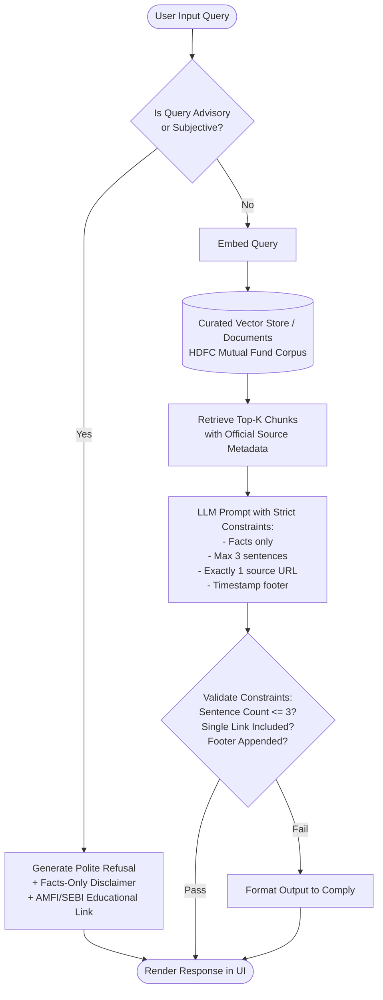

# Problem Statement: Facts-Only Mutual Fund FAQ Assistant (Milestone RAG)

## 1. Executive Summary

In the financial domain—specifically mutual fund investments—providing inaccurate, speculative, or unverified information carries severe regulatory, financial, and reputational risks. Retail investors and support teams frequently encounter repetitive, factual queries regarding scheme parameters (such as expense ratios, exit loads, riskometer ratings, and minimum investment amounts).

The **Milestone RAG** project aims to build a **lightweight, facts-only Retrieval-Augmented Generation (RAG) FAQ Assistant** with **Groww** as the reference product context. The assistant strictly operates on a curated corpus of official, verifiable public documents (such as Asset Management Company [AMC] disclosures, AMFI, and SEBI regulations). It strictly prioritizes **accuracy over speculative intelligence**, refusing any advisory, subjective, or comparative investment questions while providing concise, source-backed answers for factual queries.

---

## 2. Core Problem Definition

### 2.1 The Challenge
1. **Hallucination & Advisory Liability:** Traditional Large Language Models (LLMs) tend to generalize, speculate, or give subjective financial opinions (e.g., "This fund is a great pick for high returns"). Under SEBI (Securities and Exchange Board of India) guidelines, offering unregistered investment advice or performance promises is strictly prohibited.
2. **Information Fragmentation:** Critical fund parameters (exit load structures, cut-off timings, benchmark indices, tax implications) are dispersed across Scheme Information Documents (SIDs), Key Information Memorandums (KIMs), and fund factsheets.
3. **Customer Support Load:** Support teams spend substantial manual effort answering basic, repetitive questions that could be automated reliably if accuracy and verifiable citations are guaranteed.

### 2.2 Guiding Philosophy
> **"Accuracy over Intelligence"**  
> The system must never guess, extrapolate, or offer financial guidance. If an answer cannot be grounded explicitly in official corpus documents, the system must acknowledge its inability to answer or direct the user to official resources.

---

## 3. Project Objectives

- **Factual Grounding:** Retrieve and synthesize answers exclusively from designated official public sources without third-party bias.
- **Strict Guardrails & Refusal Handling:** Detect and gracefully decline advisory, opinion-based, or comparative questions, redirecting users to investor education resources.
- **Concise & Source-Attributed Responses:** Ensure all answers adhere to strict output formatting (maximum 3 sentences, exactly one citation link, and an update timestamp footer).
- **Multi-Thread Interaction:** Provide a clean, minimal user interface supporting multiple concurrent and independent conversation sessions.

---

## 4. Target Users & Use Cases

| User Group | Primary Need | Typical Queries / Scenarios |
| :--- | :--- | :--- |
| **Retail Investors** | Quick, verifiable verification of fund rules and scheme specifics without sales pitch or bias. | "What is the exit load for HDFC Mid-Cap Opportunities Fund?", "What is the minimum SIP amount?" |
| **Customer Support Teams** | Rapid reference tool for resolving customer inquiries accurately with official proof links. | "How can an investor download a capital gains statement?", "What is the lock-in period for ELSS?" |
| **Content & Operations Teams** | Verifying scheme attributes, benchmark names, and risk ratings for catalog maintenance. | "What is the benchmark index for HDFC Multi-Cap Fund?", "What is the current riskometer classification?" |

---

## 5. Scope of Work

### 5.1 Corpus Definition & Data Ingestion
The assistant focuses on a single Asset Management Company: **HDFC Mutual Fund**, using product and scheme information referenced from Groww and official AMC sources.

#### Target Scheme Corpus
| # | Scheme Name | Category | Reference URL |
| :-: | :--- | :--- | :--- |
| 1 | **HDFC Mid-Cap Opportunities Fund** | Mid Cap Equity | [Groww Scheme Page](https://groww.in/mutual-funds/hdfc-mid-cap-fund-direct-growth) |
| 2 | **HDFC Small Cap Fund** | Small Cap Equity | [Groww Scheme Page](https://groww.in/mutual-funds/hdfc-small-cap-fund-direct-growth) |
| 3 | **HDFC Top 100 Fund (Large Cap)** | Large Cap Equity | [Groww Scheme Page](https://groww.in/mutual-funds/hdfc-large-cap-fund-direct-growth) |
| 4 | **HDFC Silver ETF Fund of Fund (FoF)** | Commodities / Silver FoF | [Groww Scheme Page](https://groww.in/mutual-funds/hdfc-silver-etf-fof-direct-growth) |
| 5 | **HDFC Multi-Cap Fund** | Multi Cap Equity | [Groww Scheme Page](https://groww.in/mutual-funds/hdfc-multi-cap-fund-direct-growth) |

---

### 5.2 Supported Query Types (Facts-Only)
The assistant answers objective, factual queries, including but not limited to:
- **Expense Ratio:** Direct vs. Regular plan expense ratios.
- **Exit Load Structure:** Holding period thresholds and applicable exit fee percentages.
- **Investment Limits:** Minimum Lump sum and minimum Systematic Investment Plan (SIP) amounts.
- **Lock-in Periods:** Mandatory lock-ins (e.g., 3-year lock-in for ELSS).
- **Riskometer Rating:** Standard risk classifications (Low, Moderately Low, Moderate, Moderately High, High, Very High).
- **Benchmark Index:** Scheme benchmark (e.g., NIFTY Midcap 150 TRI, NIFTY 500 TRI, etc.).
- **Operational Procedures:** Step-by-step guidance to download account statements or capital gains reports.

---

### 5.3 Response Formatting Constraints
Every factual response generated by the assistant must strictly comply with the following constraints:

1. **Length Limit:** Maximum of **3 sentences** in the main answer body.
2. **Single Citation:** Exactly **one valid citation link** to the official source.
3. **Mandatory Footer:** Must terminate with the metadata footer:
   ```text
   Last updated from sources: <YYYY-MM-DD>
   ```

#### Example Valid Factual Response:
> The minimum SIP investment amount for HDFC Mid-Cap Opportunities Fund Direct-Growth is ₹100 per month. There is no upper limit on the investment amount.
>
> Source: [HDFC Mid-Cap Fund Details](https://groww.in/mutual-funds/hdfc-mid-cap-fund-direct-growth)  
> *Last updated from sources: 2026-10-25*

---

### 5.4 Refusal Handling & Guardrails (Advisory & Opinion Queries)
The assistant must proactively intercept and decline non-factual, subjective, or advisory queries.

#### Prohibited Query Types:
- Recommendation requests: *"Should I invest in this fund?"*, *"Is HDFC Small Cap good for me?"*
- Comparative opinions: *"Which fund is better: HDFC Mid Cap or HDFC Multi Cap?"*
- Future predictions / return estimates: *"Will this fund give 15% returns next year?"*

#### Refusal Response Requirements:
- Maintain a polite, objective, and neutral tone.
- Clearly state the facts-only restriction.
- Direct the user to official educational materials (e.g., AMFI or SEBI investor education resources).

#### Example Refusal Response:
> I am a facts-only assistant and cannot provide investment advice, scheme recommendations, or opinions on which fund is better. For guidance on mutual fund investing, please consult a SEBI-registered investment advisor or review educational resources on [AMFI India](https://www.amfiindia.com) and [SEBI Investor Education](https://investor.sebi.gov.in).
>
> *Last updated from sources: 2026-10-25*

---

### 5.5 User Interface (Minimal & Compliant)
The solution must feature a clean, user-friendly interface with:
1. **Permanent Disclaimer Banner:**  
   `"Facts-only. No investment advice."`
2. **Welcome Message:** Clear onboarding introducing the assistant's scope and guidelines.
3. **Sample Quick-Prompt Questions (Minimum 3):**
   - *"What is the exit load for HDFC Small Cap Fund?"*
   - *"What is the minimum SIP amount for HDFC Mid-Cap Fund?"*
   - *"What is the benchmark index for HDFC Multi-Cap Fund?"*
4. **Multiple Chat Thread Support:** Capability to manage independent, concurrent conversation threads with isolated context histories.

---

## 6. Architecture & System Flow



---

## 7. Strict Constraints & Compliance Matrix

| Area | Rule / Restriction | Enforcement Mechanism |
| :--- | :--- | :--- |
| **Data & Sources** | Only official public sources (AMC, AMFI, SEBI, verified Groww scheme pages). **No third-party blogs or aggregator sites.** | Curated ingestion whitelist. |
| **Data Privacy & PII** | Strictly zero collection, storage, or processing of: <br>• PAN or Aadhaar numbers<br>• Bank account / Folio numbers<br>• OTPs<br>• Personal contact info (emails, phone numbers) | Input scrubbing / regex masking & strict prompt guardrails. |
| **Investment Advice** | Absolute prohibition against providing investment recommendations, ratings, or qualitative opinions. | Pre-retrieval intent classification and system prompt guardrails. |
| **Performance Data** | No hypothetical returns or performance comparisons. Return queries must only reference the official factsheet link. | Direct link redirection without LLM extrapolation. |
| **Transparency** | Every output must have verifiable attribution and a last-updated date. | Deterministic footer template injection. |

---

## 8. Expected Deliverables

1. **`problemStatement.md`:** Comprehensive project definition and contextual reference document.
2. **`README.md`:**
   - Environment setup and execution instructions.
   - Selected AMC profile and detailed scheme roster.
   - RAG architectural overview, chunking strategy, and retrieval mechanics.
   - Known limitations, edge cases, and future enhancements.
3. **Disclaimer Component / Snippet:** Visible, persistent UI notification: `"Facts-only. No investment advice."`
4. **Multiple Chat Thread Support:** Functional backend and frontend capable of handling concurrent conversation threads independently.

---

## 9. Success Criteria

- [x] **Retrieval Accuracy:** Factual responses accurately match source documents with zero fabricated details.
- [x] **Strict Facts-Only Compliance:** 100% adherence to non-advisory constraints; zero speculative guidance.
- [x] **Citation Integrity:** Every factual response contains exactly one valid, functional citation URL.
- [x] **Graceful Refusal:** 100% interception of subjective, comparative, and recommendation prompts with educational redirection.
- [x] **Clean, Responsive UI:** Smooth multi-threaded user experience with clear disclaimers and starter prompts.
